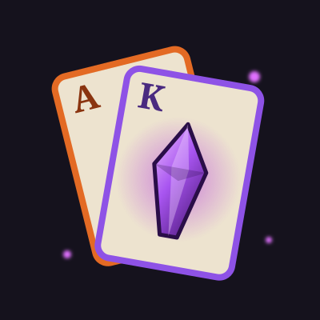

# Forever Warlock Arcade

Little Warlock games for **WoW: Forever**. Play them **in the browser** or **in the game** as an addon: the same games, from the same code.

**Play in the browser:** https://xnwlk.github.io/ForeverWarlockArcade/

The games use real numbers from the [Forever Warlock Sim](https://xnwlk.github.io/WarlockSIM/): spell crit chance, crit damage, talent and spell texts, icons.

## The games

| Game | What it is | State |
|---|---|---|
| **Shard & Mult** | A poker-hand roguelike. The suits are Shadow Bolt, Corruption, Immolate and Incinerate, J/Q/K are demons, talents are your jokers, Molten Core bosses are the blinds and Ragnaros waits at ante 8. | Playable |
| **DoT Juggler** | Training dummies keep arriving: keep Corruption, Bane of Agony and Immolate ticking on as many as you can for 90 seconds, with real cast times, global cooldown, mana, damage per tick and Life Tap. | Playable |
| **Higher or Lower** | Which build sims more DPS, which spell deals more damage in its build, which stat is worth more, which cast hits harder - every number is the sim's own. Keep the streak going. | Playable |
| **Warlockle** | The talent of the day: guess it in six tries from its tree, tier, column and ranks. The same talent for everyone, in the browser and in the game. | Playable |
| **Warlock Ware** | Seven micro-games of a few seconds each, faster and faster: Life Tap!, Queue it! (the 0.4 s spell queue), Catch the proc!, Refresh!, Pick it!, Drain Soul!, Living Bomb! | Playable |
| **Shadow Pegs** | Aim and bounce a Shadow Bolt through the pegs; clear every soul shard peg. Pegs deal the real damage of a Corruption tick, a Shadow Bolt and an Immolate. | Playable |
| **Tap Tap DPS** | The rotation is the song chart: a 120 s fight of the sim's standard character as falling notes. Casts are hold notes - let go early and the cast is interrupted. Your score is the DPS. | Playable |
| **Demon 2048** | Merge soul shards into Imps, Voidwalkers, Succubi ... all the way to the Demon Lord. | Playable |
| **Soul Circles** | The same real rotation as Tap Tap DPS, now with aim: click each spell as its ring closes in, hold casts and follow the ball to the end. Your score is the DPS, with a rank from D to SS. | Playable |
| **Warlock Connections** | Sixteen Warlock things - spells, talents, demons, consumables - hide four groups of four ("Fire spells", "Talents with 5 ranks", "Soul in the name" ...). Four mistakes allowed. A new puzzle every day, and practice puzzles. | Playable |
| **Iconle** | A spell, talent or demon icon, zoomed far in. Guess whose it is in six tries; every miss zooms out. A new icon every day, and practice icons. | Playable |
| **Type to Cast** | Spell names fall towards the fire; type them to cast them for their real damage and mana. Life Tap for mana, DoTs early (only the ticks before the end count). | Playable |
| **Spell Gems** | Swap gems to line up three spells and cast them; chain reactions hit harder. Line gems, Rain of Fire and Hellfire specials. Beat the Molten Core bosses before your moves run out. | Playable |
| **Felsweeper** | Infernals are buried in the field: open every safe square, the numbers tell how many Infernals touch it. Three sizes, best times kept. | Playable |
| **Flappy Imp** | Flap the Imp through the gaps between the lava pillars of Molten Core and collect soul shards. | Playable |
| **Perfect Rotation** | Six short fights: put the casts in the order that deals the most damage - real cast times, mana and DoT ticks, clipping included. Stars against the best order a search found. | Playable |

## In the game

**Get the addon on CurseForge:** https://www.curseforge.com/wow/addons/warlock-arcade

Or download `WarlockArcade-<version>.zip` from the [releases](https://github.com/XNWLK/ForeverWarlockArcade/releases) and unzip it into `World of Warcraft\_classic_beta_\Interface\AddOns` (it holds one folder, `WarlockArcade`). Restart the game and type `/arcade`.

## The other Warlock projects

| Project | Page | Source |
|---|---|---|
| Forever Warlock Sim: DPS simulator | https://xnwlk.github.io/WarlockSIM/ | https://github.com/XNWLK/WarlockSIM |
| Forever Warlocking: 3D rotation practice | https://xnwlk.github.io/ForeverWarlocking/ | https://github.com/XNWLK/ForeverWarlocking |
| Xn's Warlock Sim: the sim as an addon | https://www.curseforge.com/wow/addons/xns-warlock-sim | https://github.com/XNWLK/WarlockSIMAddon |

## Shuklock's project

**Shardlock Idle**, a Warlock idle game: cast Shadow Bolts, collect soul shards, level up and learn Drain Soul. Play it in the browser at https://shuklock.github.io/drain-soul/ - it is also a WoW: Forever addon.

## How it works

The games are written once, in Lua, as a WoW addon (`WarlockArcade/`). The web page runs those same Lua files with [fengari](https://github.com/fengari-lua/fengari) (a Lua engine for the browser, MIT licence) and a small stand-in for the game's frames, textures, text and mouse (`web/`). Spell icons are Wowhead's (wow.zamimg.com).
